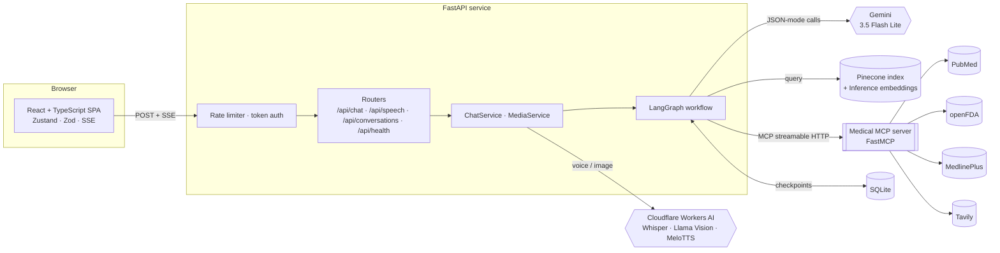
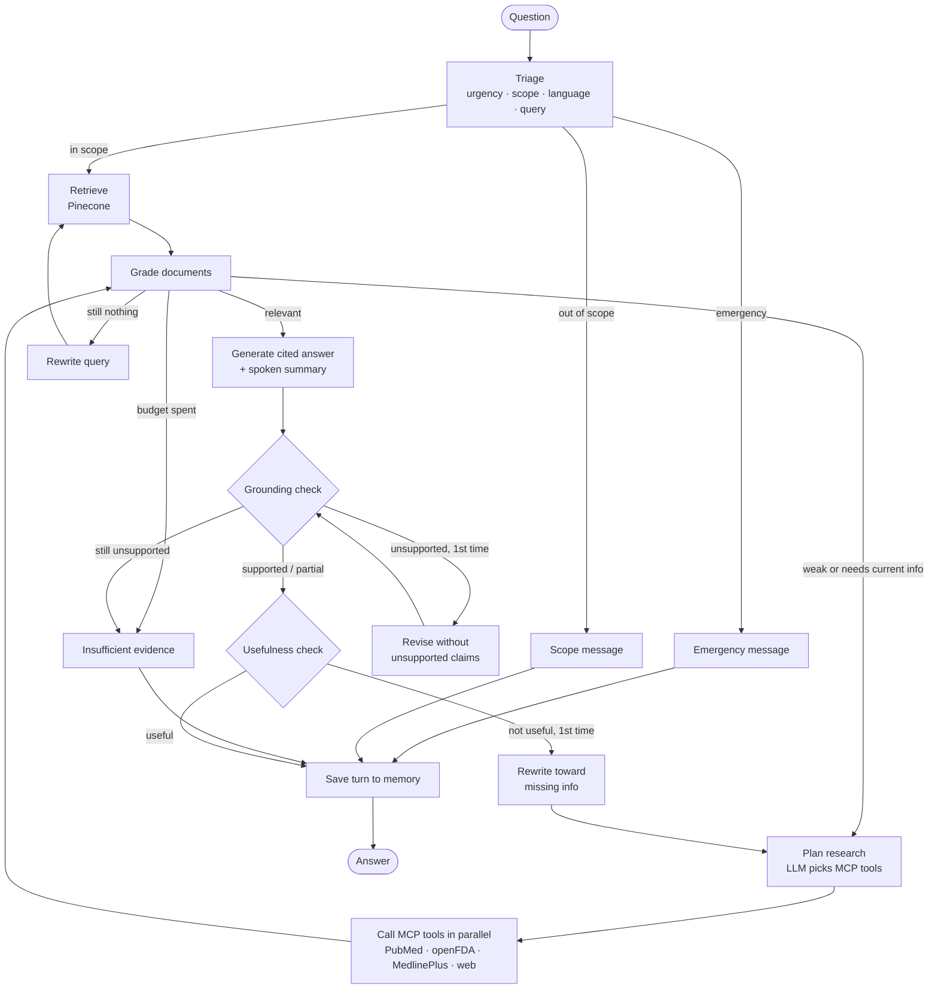

<div align="center">

# 🩺 MedGuide AI

**A production-structured, agentic medical knowledge assistant built with LangGraph, Gemini, Pinecone, FastAPI and React.**

Ask a health question by text, voice or photo. A LangGraph workflow triages it for emergencies, retrieves evidence from a private medical encyclopedia, **calls research tools through its own MCP server** (PubMed, openFDA drug labels, MedlinePlus, web) when that evidence is weak or outdated, writes a cited answer, then **checks it against its sources and against the question** before showing it. Every step is streamed live to the UI.

[](https://github.com/MamitianaRak/Medical-Agentic-Chatbot/actions/workflows/ci.yml)


</div>

> [!IMPORTANT]
> MedGuide AI is an **educational project**, not a medical device. It does not diagnose, and its
> main source is a historical encyclopedia (2002). In an emergency, call your local emergency number.

---

## Table of Contents

- [The problem](#the-problem)
- [Key features](#key-features)
- [Architecture](#architecture)
- [Agent workflow](#agent-workflow)
- [Safety by design](#safety-by-design)
- [Tech stack](#tech-stack)
- [Project structure](#project-structure)
- [Getting started](#getting-started)
- [Configuration](#configuration)
- [Testing and CI](#testing-and-ci)
- [Deployment](#deployment)
- [API reference](#api-reference)
- [Engineering decisions](#engineering-decisions)
- [Known limitations](#known-limitations)
- [Roadmap](#roadmap)
- [License](#license)

## The problem

People search their symptoms online and get either generic pages or a chatbot that answers confidently with no source. In health, both failure modes are dangerous: an emergency can be met with a long explanation, and a fluent but invented answer reads exactly like a correct one.

MedGuide AI treats a health question as an **agentic workflow with guardrails**:

- an **emergency triage** step runs first and short-circuits to a fixed emergency message, without retrieval or a long LLM answer;
- answers are built **only from retrieved evidence** and cite it (`[PDF p.394]`, `[PMID:39778920]`, `[FDA: ibuprofen]`…);
- a **relevance grader** filters every batch of evidence before generation;
- when the encyclopedia is not enough, a **research planner** picks the right external tools (served by a custom **MCP server**) and their queries; if nothing useful comes back, the **query is rewritten** and the search retried (**corrective RAG**);
- a **grounding check** verifies the answer against the evidence (revised once, then replaced by a safe "insufficient evidence" message) and a **usefulness check** verifies it answers the question, triggering one targeted research round if not (**reflective RAG**);
- the user can **speak** the question, **attach a photo** (described objectively, never diagnosed) and **listen** to a short spoken summary in their own language.

> **Examples (real runs):**
> - *"Quels sont les déclencheurs des crises d'asthme ?"* → triage `routine · fr` → 5 passages → 3 relevant → French answer citing `[PDF p.250]`, `[PDF p.394]` → `supported` · `useful`.
> - *"What are the main warnings and interactions of ibuprofen?"* → encyclopedia 0/5 relevant → planner calls `drug_label: ibuprofen` over MCP → FDA label → `supported` · `useful`.
> - *"Quels sont les traitements biologiques les plus récents pour l'asthme sévère ?"* → encyclopedia 0/4 → `pubmed: recent biologic treatments for severe asthma` → 4 articles → French answer citing `[PMID:39778920]`…

## Key features

| Area | What it does |
|------|--------------|
| **Emergency triage** | One structured LLM call returns urgency (emergency / urgent / routine), scope, language and a standalone search query. Emergencies get a fixed, localized message (en/fr/es) that works even if the LLM is down; a keyword safety net catches red flags when triage output is malformed. |
| **Corrective RAG** | Private knowledge base first (Pinecone), LLM relevance grading, then an LLM research planner that calls MCP tools; if the evidence is still weak, the query is rewritten and the search retried, within strict budgets. |
| **Custom MCP server** | `app/mcp_servers/medical_server.py` (FastMCP) exposes `search_pubmed`, `drug_label` (openFDA, dosing deliberately excluded), `health_topic` (MedlinePlus) and `web_search` (Tavily). Served over **streamable HTTP** as a long-lived process (Docker, Render, its own compose service) with DNS rebinding protection, or over stdio for quick local runs. Tools run in parallel; a failing API only loses its own results. |
| **Reflective RAG** | Grounding check (revise once, then refuse) and usefulness check (one targeted research round driven by what is missing). |
| **Cited answers** | Every claim cites a short label (`PDF p.N`, `PMID:…`, `FDA: …`, `MedlinePlus: …`, `Web: domain`); the UI renders them as chips and lists sources with their score or origin. |
| **Multimodal** | Voice questions (Whisper large v3 turbo), image observations (Llama 3.2 11B Vision), spoken summaries (MeloTTS) in the detected language. |
| **Conversation memory** | LangGraph checkpoints in SQLite; follow-up questions are rewritten into standalone queries. Conversations are listable and deletable. |
| **Live streaming** | Server-Sent Events emit one event per workflow node; the UI shows the agent trace as it runs. |
| **Production hygiene** | App factory, typed settings, JSON logs with request IDs, rate limiting, optional bearer token, consistent error bodies, provider errors mapped to 503/504, health and readiness probes, non-root containers, CI. |
| **Inspector UI** | Three-column workspace: consultations, chat, and an inspector with the node-by-node trace, the MCP tool calls, run metadata (source, grounding, usefulness), sources and the models in use. Clinical light theme, optional dark theme. |

## Architecture



**Request flow**

1. The SPA posts the question (and an optional image) to `/api/chat/stream` and reads the SSE stream.
2. If an image is attached, `ChatService` asks Llama 3.2 Vision for an objective description first.
3. The graph runs on the conversation's `thread_id`; each finished node emits a `step` event with a short detail (`3/5 relevant`, `supported`…).
4. The final `result` event carries the answer, the spoken summary, the language, urgency, grounding verdict, citations and the full trace.

## Agent workflow



| Node | Responsibility | LLM call |
|------|----------------|----------|
| `triage` | Urgency, scope, language, standalone English search query (uses memory and image observations) | Gemini |
| `emergency` / `out_of_scope` / `insufficient` | Fixed, localized messages | none |
| `retrieve` | Top-k passages from Pinecone (`input_type=query`), score floor 0.30 | none |
| `grade_documents` | Keeps only evidence that helps answer (KB chunks and tool results alike) | Gemini |
| `plan_research` | Chooses up to 3 MCP calls (tool + English query), never repeating one | Gemini |
| `call_tools` | Runs the calls in parallel through the MCP client | none |
| `rewrite_query` | Reformulates the search with precise medical terms or toward missing facts | Gemini |
| `generate` / `revise` | Cited Markdown answer + 2–4 sentence spoken summary, in the user's language | Gemini |
| `check_grounding` | `supported`, `partial` or `unsupported`, with the unsupported claims | Gemini |
| `check_usefulness` | Does the answer address the question? If not, what is missing | Gemini |
| `finalize` | Appends the turn to the conversation memory | none |

**Budgets** keep cost and latency bounded: at most 3 tool calls per research round, 2 research rounds, 1 query rewrite, 1 revision. A question answered from the encyclopedia costs **5 Gemini calls** (triage, grading, generation, grounding, usefulness); one that needs research adds 2 (planning, grading). All calls use JSON mode, and a malformed reply is asked again once.

## Safety by design

- **Emergencies never wait for retrieval.** The emergency path is a fixed message, so it works during a provider outage. If triage output cannot be parsed, a red-flag keyword check (chest pain, unconscious, suicidal intent…, in English and French) still routes to it.
- **No unverified answer is shown as verified.** An unparseable grounding verdict counts as `unsupported`; after one revision an unsupported answer is replaced by an "ask a clinician" message.
- **Retrieved text and tool results are data, not instructions**: prompts say so explicitly, which limits prompt injection from web pages.
- **Read-only tools, no dosing**: the MCP server only reads public APIs, and the FDA tool never returns dosage sections; the assistant does not prescribe.
- **Images are described, not diagnosed**: the vision prompt forbids diagnosis and severity estimates, and the description is passed to the agent as an observation.
- **Outdated source flagged**: the encyclopedia dates from 2002; answers based on it say so, and questions about current guidelines trigger the web search.

## Tech stack

| Layer | Technology |
|-------|------------|
| Agents | LangGraph (state graph, conditional routing, SQLite checkpointer), LangChain Core |
| LLM | Google Gemini `gemini-3.5-flash-lite` in JSON mode (configurable) |
| Retrieval | Pinecone serverless index, Pinecone Inference `llama-text-embed-v2` (768 dims) |
| Tools | Custom MCP server (FastMCP, streamable HTTP or stdio) via `langchain-mcp-adapters`: PubMed E-utilities, openFDA, MedlinePlus, Tavily |
| Speech and vision | Cloudflare Workers AI: `whisper-large-v3-turbo`, `llama-3.2-11b-vision-instruct`, `melotts` |
| API | FastAPI, Pydantic v2, pydantic-settings, Server-Sent Events, Uvicorn |
| Persistence | SQLite: LangGraph checkpoints + conversation index |
| Frontend | React 19, TypeScript, Vite, Zustand, Zod, react-markdown, lucide-react |
| Quality | Pytest + coverage (fake LLM, KB, research tools and media: no network), Ruff, Vitest + Testing Library |
| Delivery | Docker (non-root, health check), nginx, Docker Compose, Render Blueprint, GitHub Actions |

## Project structure

```text
.
├── app/                          # FastAPI backend
│   ├── main.py                   # App factory, production wiring, middleware
│   ├── api/                      # HTTP layer
│   │   ├── chat.py               #   chat (JSON + SSE) and conversations
│   │   ├── speech.py             #   transcription and speech synthesis
│   │   ├── health.py             #   liveness / readiness probes, model names
│   │   ├── schemas.py            #   request / response models, image validation
│   │   ├── deps.py               #   service injection, token auth, rate limiting
│   │   └── errors.py             #   consistent {success, error, code} errors
│   ├── core/                     # Cross-cutting concerns
│   │   ├── config.py             #   typed settings from env / .env
│   │   ├── logging.py            #   text or JSON logs with request IDs
│   │   ├── llm.py                #   Gemini factory (JSON mode, timeouts, retries)
│   │   ├── errors.py             #   provider error classification
│   │   └── rate_limit.py         #   sliding-window limiter
│   ├── agents/                   # LangGraph workflow
│   │   ├── graph.py              #   graph construction and routing
│   │   ├── nodes.py              #   triage, retrieval, research, rewrite, answer, reflection
│   │   ├── prompts.py            #   prompts and fixed localized safety messages
│   │   ├── state.py              #   MedicalState, passages, node labels
│   │   ├── text.py               #   JSON parsing and evidence formatting
│   │   └── tools.py              #   KnowledgeBase / ResearchTools interfaces, tool catalog
│   ├── integrations/             # Provider adapters
│   │   ├── pinecone_kb.py        #   index, embeddings, search, ingestion helpers
│   │   ├── mcp_toolbox.py        #   MCP client: tool calls -> citable passages
│   │   └── workers_ai.py         #   Whisper, Llama Vision, MeloTTS over REST
│   ├── mcp_servers/
│   │   └── medical_server.py     # Custom MCP server: PubMed, openFDA, MedlinePlus, web
├── scripts/start.sh              # Container entry point: MCP server + uvicorn
│   └── services/
│       ├── chat_service.py       #   ask / stream / history / delete use cases
│       ├── media.py              #   speech and vision use cases
│       └── conversations.py      #   SQLite conversation index
├── scripts/ingest.py             # Resumable PDF ingestion into Pinecone
├── frontend/                     # React + TypeScript SPA
│   ├── src/api/                  #   typed client, Zod schemas, SSE parser
│   ├── src/store/                #   Zustand chat state
│   ├── src/components/           #   sidebar, chat, composer, inspector
│   ├── Dockerfile                #   multi-stage build → nginx
│   └── nginx.conf.template       #   SPA + /api proxy with SSE support
├── tests/                        # Pytest suite with network-free fakes
├── data/Medical_book.pdf         # Knowledge base source (Gale Encyclopedia, vol. 1)
├── Dockerfile · docker-compose.yml · render.yaml
└── .github/workflows/ci.yml      # Lint, tests, builds
```

## Getting started

### Prerequisites

Python 3.11+, Node.js 24, and API keys for **Google AI Studio** (Gemini), **Pinecone**, **Cloudflare Workers AI** (account ID + API token with Workers AI permission) and optionally **Tavily** (web tool) and **NCBI** (higher PubMed rate limit). PubMed, openFDA and MedlinePlus need no key.

### 1. Backend

```bash
conda create -n medguide python=3.11 -y
conda activate medguide
pip install -r requirements-dev.txt

cp .env.example .env        # then fill in the keys
```

### 2. Build the knowledge base (once)

```bash
python -m scripts.ingest --pdf data/Medical_book.pdf
```

The script creates the Pinecone index if needed (768 dims, cosine), embeds every page in chunks with Pinecone Inference, and is **resumable**: chunk ids are content hashes, so a re-run skips what is already indexed. Use `--reset` to empty the namespace first.

### 3. Run

```bash
python run.py                         # API on http://127.0.0.1:8000 (docs at /docs)
# MCP tools: with MCP_TRANSPORT=stdio (default) the server is spawned on demand.
# For the faster long-lived mode, run it in another terminal and set MCP_TRANSPORT=http:
python -m app.mcp_servers.medical_server --transport http

cd frontend && npm install && npm run dev   # UI on http://localhost:5173
```

Vite proxies `/api` to the backend, so no CORS setup is needed in development. Check `http://127.0.0.1:8000/api/health/ready` first: every check should be `ok`.

## Configuration

All settings are environment variables (see [.env.example](.env.example)).

| Variable | Default | Purpose |
|----------|---------|---------|
| `GOOGLE_API_KEY` | — | Gemini (**required**) |
| `PINECONE_API_KEY` | — | Pinecone index and embeddings (**required**) |
| `CLOUDFLARE_ACCOUNT_ID`, `CLOUDFLARE_API_TOKEN` | — | Workers AI speech and vision (**required**) |
| `RESEARCH_TOOLS` | `true` | Enable the MCP research tools |
| `TAVILY_API_KEY` | empty | Enables the `web` MCP tool |
| `NCBI_API_KEY` | empty | Optional, raises PubMed rate limits |
| `MAX_TOOL_CALLS` / `MAX_RESEARCH_ROUNDS` / `MAX_QUERY_REWRITES` | `3` / `2` / `1` | Corrective-loop budgets |
| `USEFULNESS_CHECK` | `true` | Reflective usefulness check (needs `GROUNDING_CHECK`) |
| `MCP_TRANSPORT` / `MCP_URL` | `stdio` / `http://127.0.0.1:8001/mcp` | How the API reaches the MCP server (`http` in Docker and on Render) |
| `GEMINI_MODEL` | `gemini-3.5-flash-lite` | LLM for every agent step |
| `PINECONE_INDEX_NAME` / `PINECONE_NAMESPACE` | `medguide-kb` / `medical-kb` | Where the encyclopedia is indexed |
| `EMBED_MODEL` / `EMBED_DIMENSIONS` | `llama-text-embed-v2` / `768` | Pinecone Inference embeddings |
| `RETRIEVAL_TOP_K` / `RETRIEVAL_MIN_SCORE` | `5` / `0.30` | Retrieval breadth and score floor |
| `GROUNDING_CHECK` / `MAX_GROUNDING_RETRIES` | `true` / `1` | Answer self-check and revisions |
| `MEMORY_TURNS` | `4` | Previous turns given to triage and generation |
| `TTS_DEFAULT_LANG` | `en` | Voice used when the answer language is unknown |
| `DATABASE_PATH` | `data/medguide.db` | SQLite checkpoints and conversations |
| `API_TOKEN` | empty | When set, `/api/*` (except health) requires `Authorization: Bearer` |
| `RATE_LIMIT_REQUESTS` / `RATE_LIMIT_WINDOW_SECONDS` | `20` / `60` | Per-IP limit on chat and speech |
| `CORS_ORIGINS` | `http://localhost:5173` | Allowed browser origins |
| `LOG_JSON` | `false` | JSON log lines with request IDs |

## Testing and CI

```bash
pytest --cov=app                  # backend: 80+ tests, no network, no API keys
ruff check app tests scripts && ruff format --check app tests scripts

cd frontend && npm run typecheck && npm test && npm run build
```

The backend suite runs the **real LangGraph graph** with a fake chat model (a genuine LangChain `BaseChatModel` that recognizes each agent prompt), a fake knowledge base, fake research tools and a fake media provider. It covers every route: emergency, out of scope, KB answer, MCP research, mixed sources, planner budget and fallback, failing tool, query rewrite then retry, insufficient evidence, revision, usefulness-driven research, malformed LLM output at each step (with one retry), memory, image observations. The MCP server is tested with `httpx.MockTransport` (PubMed XML, openFDA, MedlinePlus, Tavily, API failures) and the MCP client with a fake MCP session. Plus the HTTP layer: SSE, errors, rate limit, auth, conversations, speech.

GitHub Actions runs three jobs on every push and pull request: backend (Ruff + pytest with coverage), frontend (typecheck + Vitest + build) and Docker image builds.

## Deployment

### Docker Compose

```bash
cp .env.example .env   # fill in the keys
docker compose up --build
# UI on http://localhost:8080, API on http://localhost:8000/docs
```

Three services: `mcp` (the research MCP server over streamable HTTP), `api` and `web`. nginx serves the SPA and proxies `/api` with buffering disabled so SSE steps arrive live. Conversations are stored in a named volume.

### Render

[render.yaml](render.yaml) defines a Docker web service for the API and a static site for the frontend. The API container starts the MCP server once on `127.0.0.1:8001` next to uvicorn ([scripts/start.sh](scripts/start.sh)), so the free plan's 512 MB and 0.1 CPU are not spent spawning a server per tool call. Create a Blueprint from the repository, then fill in the secrets it asks for (`GOOGLE_API_KEY`, `PINECONE_*`, `CLOUDFLARE_*`, `TAVILY_API_KEY`, `CORS_ORIGINS` = the static site URL, `VITE_API_BASE_URL` = the API URL).

## API reference

| Method | Path | Description |
|--------|------|-------------|
| `POST` | `/api/chat` | Answer a question: `{message, thread_id?, image_data?}` → answer, spoken summary, urgency, grounding, citations, trace |
| `POST` | `/api/chat/stream` | Same, as SSE: `start`, one `step` per node, then `result` (or `error`) |
| `GET` | `/api/conversations` | Recent conversations |
| `GET` | `/api/conversations/{thread_id}` | Messages of a conversation |
| `DELETE` | `/api/conversations/{thread_id}` | Delete a conversation and its memory |
| `POST` | `/api/speech/transcribe` | Multipart audio → `{text}` |
| `POST` | `/api/speech/synthesize` | `{text, language?}` → MP3 |
| `GET` | `/api/health` | Liveness, version and model names |
| `GET` | `/api/health/ready` | Readiness: configuration and database |

Errors always use `{"success": false, "error": "...", "code": "..."}`: `invalid_request` (400), `unauthorized` (401), `conversation_not_found` (404), `image_too_large` (413), `rate_limited` (429, with `Retry-After`), `provider_rate_limited` / `media_unavailable` (503), `upstream_timeout` (504).

## Engineering decisions

- **One triage call instead of four.** Urgency, scope, language and query rewriting come from a single JSON call, which keeps a typical answer at five LLM calls and within free-tier quotas.
- **A long-lived HTTP MCP server in production.** Over stdio, each tool call spawned a ~60 MB Python process with ~2 s of startup, three at a time for a research round: too much for a 512 MB / 0.1 CPU instance. Over streamable HTTP the cost is paid once, and the same ibuprofen question went from 16 s to 10 s end to end. stdio stays available for zero-setup local runs.
- **A custom MCP server rather than direct API calls.** The tools get a standard, discoverable interface: the same server can be plugged into Claude Desktop, Cursor or any MCP client. The graph only sees a `ResearchTools` protocol, so it is tested without MCP or network.
- **The LLM plans, the code enforces.** The planner chooses tools and queries, but the code filters unavailable tools, drops repeated calls and caps the number of calls, rounds, rewrites and revisions.
- **Tool results go through the same relevance grader** as encyclopedia chunks, so a noisy web or PubMed result is filtered before it can reach the answer.
- **Fixed messages for safety paths.** Emergency, out-of-scope and insufficient-evidence answers are templates, never generated: they are instant, predictable and survive provider outages.
- **Fail-safe defaults per step.** Malformed triage fails open on scope but keeps the red-flag check; malformed grading keeps all candidates (the grounding check still guards); malformed grounding counts as unsupported.
- **Pinecone Inference for embeddings.** The Gemini free tier allows 100 embedding requests per minute; Pinecone Inference embeds the whole book (~3,100 chunks) with the same API key as the index.
- **Image analysis outside the graph.** The image is described before the graph runs, so a 5 MB data URL is never written into every checkpoint.
- **Protocols at the edges.** The graph depends on `KnowledgeBase` / `ResearchTools` interfaces and the services on a `MediaProvider`, so the full workflow is tested without network access.
- **`pinecone==7.3.0` pinned.** Pinecone 8 requires `orjson`, whose native DLL is blocked by Windows Smart App Control on the development machine.

## Known limitations

- The knowledge base is a **2002 encyclopedia covering letters A–B only**; answers outside it depend on the research tools.
- PubMed abstracts are research literature, not patient guidance; interpreting them may need a clinician.
- SQLite and the in-memory rate limiter fit **a single instance**. On Render's free plan the disk is reset on each deploy, so conversations are lost; a paid disk, or PostgreSQL + Redis, is needed to scale out.
- The optional bearer token is a shared secret, suitable for a private demo, not for user accounts.
- Free-tier quotas (Gemini, Workers AI) can return 503 under load.
- The grounding check is itself an LLM judgment, not a guarantee.

## Roadmap

- Token-by-token streaming of the answer (structured output currently arrives at once).
- Evaluation set (triage accuracy, faithfulness, citation precision) run in CI.
- User accounts and per-user conversation storage.
- Current clinical sources (e.g. national guidelines) as a second knowledge base namespace or MCP tool.
- Authenticate the MCP server so it can be exposed to other MCP clients beyond the private network.

## License

[Apache 2.0](LICENSE). The bundled PDF remains under its own copyright; check its license before hosting or redistributing it.
